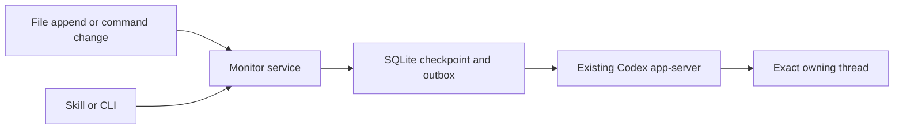

# codex-monitor

Persistent file and command watchers that deliver external tool output to the
owning **Codex CLI conversation**, including while that conversation is idle.

[中文说明](README.zh-CN.md)

Inspired by [AbnerAI/dsh-monitor](https://github.com/AbnerAI/dsh-monitor). This is
an independent Python implementation for Codex, not a DeepSeek Harness plugin.
The watcher service uses only the standard library. Automatic iTerm2 display
setup has a separate, optional Python client. No Claude Code installation or
binary patch is involved.

## Requirements

- macOS or Linux, Python 3.9+ for the standard-library watcher service. Windows:
  use WSL. The optional automatic iTerm2 indicator additionally needs macOS,
  iTerm2's Python API, and the `iterm2` Python client described below.
- A compatible Codex CLI **shared app-server** running under your account.
  The implementation targets the 0.166.0 protocol, including Unix WebSockets,
  `thread/read` and `turn/start.toolOutput`. Other versions must be checked;
  desktop-only sessions and `codex --no-daemon` are not supported by default.
- Normal Codex authentication remains in Codex. The monitor does not read or
  copy API keys, OAuth tokens, or Claude configuration.

## Install from GitHub source

Clone or download this repository, then from its root:

```bash
python3 scripts/install.py
```

The offline installer creates:

| Artifact | Default location |
|---|---|
| Service code | `~/.local/share/codex-monitor/codex_monitor/` |
| Command | `~/.local/bin/codex-monitor` |
| Codex skill | `~/.agents/skills/codex-monitor/` |

Add `~/.local/bin` to PATH if needed. Existing files are backed up on reinstall.
The installer neither edits Codex configuration nor starts services by default.
Use `--start` to start the monitor after installation. Custom destinations:
`--prefix`, `--bin-dir`, `--skill-dir`; use `--no-skill` for service-only installs.
Restart/open a Codex session if its skill catalog does not refresh automatically.

To run without installing anything, substitute `python3 -m codex_monitor` for
`codex-monitor` while your cwd is this repository. `pip install .` installs the
service CLI only; use the source installer or copy `skills/codex-monitor` to your
Codex skill directory when you also want the skill.

## Use from Codex

Ask your Codex agent:

```text
$codex-monitor Watch /tmp/codex-inbox.ndjson and tell this conversation about new messages.
$codex-monitor Run this status check every 30 seconds and report changes: cat /tmp/job-status.txt
$codex-monitor List my watchers.
$codex-monitor Stop monitor-ID.
```

The skill calls the real monitor service through the CLI. There is no required
MCP registration, custom Codex build, or hidden Monitor tool.

## CLI quick start

Run `doctor` and register watchers from a shell tool **inside the intended Codex
conversation**, where `CODEX_THREAD_ID` and `CODEX_HOME` identify the owner:

```bash
codex-monitor doctor
codex-monitor start
codex-monitor watch --file /tmp/codex-inbox.ndjson --name inbox
```

From another terminal, append a complete record:

```bash
printf '{"content":"The job finished."}\n' >> /tmp/codex-inbox.ndjson
```

The file can be created after registration. Existing contents are skipped by
default; use `--from-start` to replay them. A string `content` field is extracted
from JSON; otherwise the complete line is delivered as text.

Commands are **short checks re-executed periodically**, not long-running streams:

```bash
codex-monitor watch --command 'cat /tmp/job-status.txt' --interval 30 --timeout 5 --name job
codex-monitor list
codex-monitor events --id monitor-ID
codex-monitor events --id monitor-ID --content
codex-monitor unwatch monitor-ID
codex-monitor stop
```

`--once` stops a watcher after its first accepted batch. `stop` stops the service
but retains active registrations for its next `start`; `unwatch` stops a watcher
and cancels its unsent events. Control commands return JSON. `statusline` can
print a plain label, and `launch` preserves the original Codex terminal output.

Outside Codex, supply an exact UUID and profile explicitly:

```bash
codex-monitor watch --file /tmp/codex-inbox.ndjson \
  --thread EXACT-THREAD-UUID --codex-home /absolute/path/to/codex-home
```

Global `--state-dir` belongs **before** the subcommand. `CODEX_MONITOR_HOME`
changes its default. `--codex-bin`/`CODEX_MONITOR_CODEX_BIN` choose the Codex CLI;
`--socket` selects an explicit owning app-server Unix socket. The service never
guesses the newest conversation or switches a global Codex profile.

## Optional iTerm2 indicator

The indicator counts active watchers for one exact Codex thread and normalized
`CODEX_HOME`: two show `monitor-2`, one shows `monitor-1`, and zero is blank.
It uses an iTerm2 status-bar component rather than Codex's native footer.

### Automatic setup for new Codex shells

This opt-in path lets you keep typing `codex` in new interactive zsh shells.
It wraps only that command, leaving the original Codex executable or account/
`CODEX_HOME` selection wrapper in place. It does not wrap `claude`, modify Claude
Code settings, reload existing shells, or close/restart iTerm2.

Install the service and skill first with `python3 scripts/install.py`. Then:

1. In iTerm2, enable **Settings > General > Magic > Enable Python API** once.
   This is a user-controlled global API switch, separate from the per-session
   layout changes. The installer does not enable it. Keep the default API
   authentication; **Allow all apps to connect** is not required.
   No iTerm2 restart or closing of existing shells is needed. You do not need
   to change **Profiles > Session > Status bar** for automatic setup.
   If macOS requests Automation permission on first connection, allow the
   terminal or launcher to communicate with iTerm2 through the normal prompt.
2. Install the optional client in its own runtime:

   ```bash
   python3 -m venv ~/.local/share/codex-monitor/iterm-runtime
   ~/.local/share/codex-monitor/iterm-runtime/bin/python -m pip install 'iterm2>=2.30,<3'
   ```

3. Preview the managed zsh block, then opt in:

   ```bash
   python3 scripts/install_iterm.py
   python3 scripts/install_iterm.py --install
   ```

From the intended current iTerm2 shell, check the optional API connection:

```bash
codex-monitor iterm api-status
```

This read-only command validates the exact current session UUID and single-pane
condition, then reads its two status-bar settings. A successful response includes
`"api_available": true`. It does not change settings or register a watcher.

The preview command `python3 scripts/install_iterm.py` is read-only and prints
only the proposed managed block, not
your existing rc contents. Installation backs up `~/.zshrc`, preserves unrelated
contents and its file mode, and adds a function for future interactive shells.
It skips an existing `codex` function or alias. No existing shell is sourced or
reloaded. When the managed function is active, open a new shell when ready and
use `codex` normally; you do not need to add the component manually in each new
Codex shell. If you already have a function or alias, integrate the explicit
launcher command below into it yourself instead of replacing it blindly.
In the new shell, `whence -w codex` should report a function and
`whence -p codex` should still identify the original executable on PATH.
Ensure `~/.local/bin` is on PATH if you invoke `codex-monitor` by name.

For each eligible local TUI launch, the typed iTerm2 API helper snapshots only
that terminal session's status-bar layout and enabled state. It preserves the
existing components, appends the counter only if missing, and enables the bar
for the Codex run. Shared iTerm2 profiles and global layout preferences are not
edited. `codex exec`, help/version queries, remote or `--no-daemon` launches,
non-TTY invocations, and non-iTerm2 terminals skip automatic display setup.
The current adapter requires a single-pane tab; unsupported layouts start
Codex without this optional indicator.

When a `watch` command registers a watcher, it can attach the indicator using a
fresh launcher token, a private live lease, the exact terminal UUID, and the
current thread/profile. The token and terminal identity are passed into that
Codex invocation's tool environment, so an unrelated shared app-server's old
environment is not used as routing evidence. Without a valid launch token,
watching does not invent an automatic terminal binding. An indicator failure
does not discard an already-registered watcher.

Normal Codex exit clears the counter and restores the captured status-bar
settings if they still match the layout applied by the launcher. Layout edits
made by the user while Codex runs are preserved. Watchers and the service are
not stopped by display cleanup. If the launcher is killed with `SIGKILL`, counter
clearing may wait until the terminal becomes current; a blank bar may remain
until the next Codex launch repairs the stale layout. Cleanup after a hard kill
is not guaranteed to run immediately.

For an explicit launch without the zsh function:

```bash
codex-monitor launch --codex /absolute/path/to/original/codex -- resume --last
```

For a custom optional-runtime location, set `CODEX_MONITOR_ITERM_PYTHON` to its
Python executable. To remove only the managed startup block:

```bash
python3 scripts/install_iterm.py --uninstall
```

This does not terminate running Codex sessions, disable the API, remove the
runtime, or alter the original `codex` entry point. With the API enabled, a live
lifecycle check in the authorized current shell passed automatic component
addition, exact-thread binding, `monitor-2`, exit clearing, and restoration of
the original layout. That check did not open another iTerm2 window or start a
fresh interactive Codex TUI. The core service and manual indicator remain
usable while the Python API is disabled; see [validation notes](docs/validation.md).

### Manual setup in the current session

This path needs neither the Python API nor its optional client. Publish the
intended conversation's count in the authorized current terminal session:

```bash
codex-monitor iterm attach
codex-monitor iterm status
codex-monitor iterm detach
```

Run these from the intended Codex conversation with that iTerm2 session current.
`attach` binds its exact thread and normalized `CODEX_HOME`, checks the iTerm2
session UUID and single-pane tab, and starts a count updater. Only active watchers
in that scope count: two show `monitor-2`; zero is blank. If another iTerm2 session
becomes current, the updater pauses instead of looking for or changing it. The
value may lag while paused. `detach` stops the updater and restores the prior
`user.codexMonitor` value; it does not stop watchers or the monitor service.
After changing the Codex thread or profile, detach and attach again for the exact
new target. The attachment never infers or follows a replacement target.

To show the variable, open **Session > Edit Session > Session > Status bar >
Configure** in that session. Enable the status bar if needed. Drag
**Interpolated String** from the upper **Status Bar Component Menu** to the lower
**Active Components** area. Select the new active component, click
**Configure Component**, and set its String Value to:

```text
\(user.codexMonitor)
```

Use **Edit Session** to keep the change local to this shell. This manual method
publishes only `user.codexMonitor`; it does not change titles, shared profiles,
global preferences, API enablement, or other shells. The official Codex CLI,
binary, and configuration files remain unchanged.

New iTerm2 tabs, panes, and sessions do not inherit a manual **Edit Session**
setup. Use the opt-in launcher above for automatic setup when typing `codex`,
or configure a saved/dedicated iTerm2 profile separately. Without the launcher,
each new Codex thread needs an explicit `iterm attach` for its exact target,
with `detach` first when reusing an already-bound session. The current session's
existing manual setup remains valid.

Live variable publication passed blank → `monitor-2` → `monitor-1` → blank while
leaving the title format and service instance unchanged. Before the hyphen was
added, the user confirmed the original visible value `monitor2` during a
30-second check with two test-owned watchers active in the authorized current
shell. The current label format is
`monitor-N`, such as `monitor-2` or `monitor-1`. See iTerm2's
[status-bar documentation](https://iterm2.com/documentation-status-bar.html) and
[current-session settings scope](https://iterm2.com/documentation-menu-items.html#session-edit-session).

## How delivery works



The service uses Codex's documented
[Unix WebSocket and standalone tool-output APIs](https://learn.chatgpt.com/docs/app-server).
It submits `turn/start` with empty `input` and a `codex_monitor.monitor_event`
`toolOutput`. An idle thread starts a turn; a regular active turn receives queued
tool output. Source data remains external tool output, rather than a fabricated
user instruction. Model, cwd, permission and approval settings are not overridden.

Threads waiting for approval/user input, unloaded threads, and server outages
retain pending events. Reopen an unloaded thread in its owning CLI. The service
does not approve requests or restore a thread behind the user's back.

## Reliability and limits

- Source offsets and pending events commit together in SQLite. Incomplete lines
  and split UTF-8 are retained until a newline arrives. Inode replacement and
  truncation reset file reading; same-inode, same-size in-place rewrites are not
  an append-only source and are not guaranteed to be detected.
- One command poll runs at a time per watcher. Timeout, output overflow and
  nonzero exits produce change-deduplicated error events. A successful recovery
  is reported. The default timeout is 10 seconds; output/record limit is 1 MiB.
  Notice content is capped at 8 KiB per event; the full source remains available.
- Notifications are batched (up to four events per submission). `accepted` means
  Codex acknowledged a turn id, **not** that the assistant completed processing.
- A crash during submission or a lost acknowledgement marks events `uncertain`.
  They block subsequent delivery for that watcher. Inspect the thread history
  and `events --content`, then explicitly `retry EVENT_ID` if necessary. No
  exactly-once guarantee is claimed.
- File read failures/oversized records appear in `list.last_error`, with the
  cursor retained; fix the source and it will retry. No background model polling
  occurs when there are no events. Actual delivered events can incur model usage.
- Polling commands run as your monitor-service OS user, outside the target
  thread's shell sandbox. Register only commands you intend to repeat. Normal
  execution/approval policies still apply to work Codex does after notification.
- The private `~/.codex-monitor/` directory holds a socket, SQLite event data and
  logs. It must be mode 0700. Runtime history is retained until you remove it
  after stopping the service; no automatic pruning is currently performed.

## Running as a supervised service

`codex-monitor start` starts a detached local service. For login/reboot survival,
use `codex-monitor run` with your existing supervisor. Templates are provided in
`examples/` for a systemd **user** service and macOS LaunchAgent. Adjust absolute
paths in the LaunchAgent before using it. Installation does not enable login
startup automatically. Avoid running a supervised and detached service against
the same state directory; a file lock prevents duplicate ownership.

## Troubleshooting

| Symptom | Action |
|---|---|
| CLI missing | Use `~/.local/bin/codex-monitor`, fix PATH, or run the skill's wrapper. |
| Missing thread id | Register from the Codex shell or supply the exact `--thread`. |
| Socket denied | Use your host's normal approval flow; do not bypass its sandbox. |
| Socket missing | Open the owning Codex CLI with its shared daemon enabled. |
| Events remain pending | Inspect `list.last_error` and the target's input/approval state. |
| Unsupported `toolOutput` | Check your CLI/server protocol; `doctor` is connection-only. |
| Startup failure | Inspect `~/.codex-monitor/startup.log`; check state path permissions/length. |
| Automatic iTerm2 indicator unavailable | In the intended current single-pane shell, run `codex-monitor iterm api-status`; check the Python API checkbox and optional client runtime. Keep default authentication; do not enable an allow-all-applications setting. |
| New shell still uses an unwrapped `codex` | Check PATH with `whence -p codex` and the active definition with `whence -w codex`; existing aliases/functions are deliberately preserved. The managed block loads in new interactive zsh shells, without reloading running shells. |
| Counter is blank | Zero active watchers is intentionally blank. The launcher binds only after a watcher registers from the exact Codex thread; unsupported remote/non-TTY/multi-pane launches skip display setup. |

To uninstall, stop/unwatch first. The paths listed in the install table belong
to this tool; move those artifacts aside. Keep `~/.codex-monitor/` if you want
to preserve event history. Do not remove unrelated Codex or Claude directories.

## Develop, test, publish

```bash
python3 -m unittest discover -s tests -v
python3 scripts/package.py
```

Unit tests use only local fixtures; no model/account/network is needed. Some
agent sandboxes require permission to bind the tests' temporary Unix sockets.
GitHub Actions runs tests on macOS/Linux and Python 3.9/3.12/3.13.

Live tests are opt-in and use the current Codex account:

```bash
python3 scripts/session_check.py arm
```

For the actual existing conversation, run `arm` from its active shell tool, then
end the turn. An independent observer waits until that exact thread is idle,
appends a fresh marker, and checks for the agent's acknowledgement token in the
accepted turn. After wake-up, the agent must reply with the token returned by
`arm`. Read and optionally recheck the resulting evidence with:

```bash
python3 scripts/session_check.py report --directory /path/returned/by/arm
python3 scripts/session_check.py confirm --directory /path/returned/by/arm
```

This check passed on the actual current thread: the matched canonical
`agentMessage` and its returned `turnId` were verified against the accepted turn.
It does not create another conversation or override model settings. A local
WebSocket handshake or `accepted` event alone is insufficient evidence of a
model response. See [validation notes](docs/validation.md).

Separate isolated-fixture and busy-delivery checks are also available:

```bash
python3 scripts/live_check.py --mode idle
python3 scripts/live_check.py --mode busy
```

Idle mode creates a minimal isolated test conversation, waits for its first turn
to complete, appends a file record, and checks its agent acknowledgement. The
fixture keeps the current model, uses low effort/HTTP, and is archived afterward. Busy mode
submits a harmless marker to the current thread and verifies external tool-output
history. Both clean up their test monitor service. Neither is part of CI.

When the upstream model is unavailable, `--mode idle --trigger-only` checks that
a file event starts a new turn from an idle test thread and appears as external
tool output. This deliberately does **not** claim a model reply was verified.
The model-backed full test requires working inference connectivity; a successful
local WebSocket handshake alone is insufficient.

Upload this repository to your own GitHub repository; no remote is preconfigured.
The packaging script creates `dist/codex-monitor-0.1.0.zip` and
`dist/codex-monitor.skill`. Extract the latter as a skill folder; it still needs
the independently installed service. Personal paths and runtime/account data
are excluded from these release archives.

MIT licensed. This is a community integration, not an official OpenAI product.
