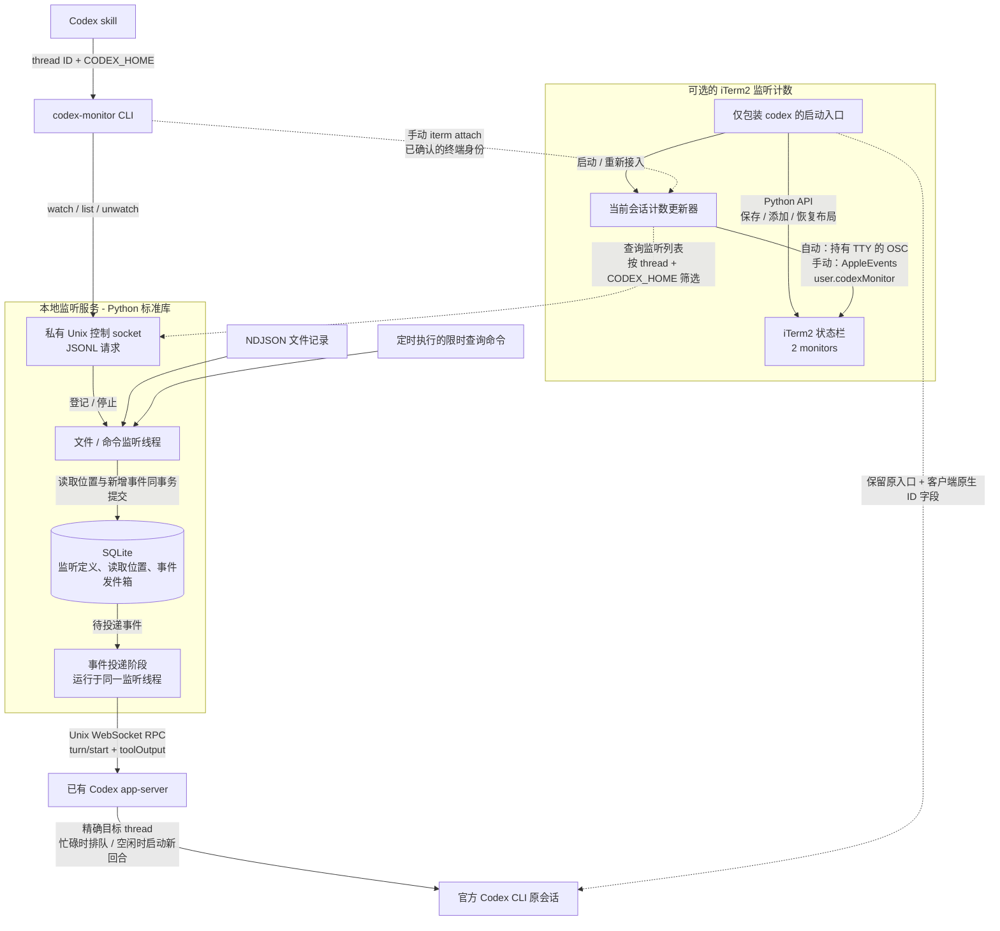

# codex-monitor

让 Codex CLI 持续监听文件或命令输出，在有新内容时通知原会话；空闲会话可以被唤醒。
由独立 Python 后台服务、CLI、Codex skill 组成。核心监听服务只用标准库；
可选的 iTerm2 自动显示功能另需独立安装 Python 客户端。

## 技术框架



skill 通过 CLI 控制常驻监听。监听线程将读取位置与新增事件在同一事务中保存，
再通过已有 app-server 投递到原 Codex 会话；等待用户输入或审批时，事件继续暂存。
可选的 iTerm2 分支只显示该会话的活跃监听数，与事件投递流程独立。

## 0.1.3 升级了什么

启动器现在原样转交用户的 Codex 参数，不再注入任何 `-c` 设置。此前注入的环境和
标题设置会让 Codex 0.166.0 排除共享 daemon，改用进程内线程；计数可见或历史可读，
都不能证明 monitor 能向该线程投递。0.1.3 修复了这一后端选择问题。

自动显示改为一次明确的持久化标题配置：先运行
`codex-monitor iterm configure-title --codex-home /ACTUAL/HOME` 只读预览，再在确认设置时
加 `--apply`。它通过官方配置 API 和版本检查，只写入 `tui.terminal_title`，对后续
使用该 home 的 Codex 启动生效。配置命令要求对应的共享 daemon 已运行。

`doctor` 会同时核验运行时加载状态和历史身份。新 watcher 在登记前会拒绝未加载、
无法核实、不支持直接输入或处于系统错误状态的线程；等待审批或输入仍属可暂存的
临时状态。`doctor` 输出结构化 JSON；`registration_ready` 为 false 时退出码为 2，
只有历史匹配也不算成功。等待审批/输入但仍可登记时保持成功退出。0.1.2 的绿色计数保留。

0.1.3 的 183 项隔离回归测试通过；真实 Codex 0.166.0 上的 `doctor` 和标题配置
只读预览通过。私有 PTY 中的真实 CLI 重试使用了用户任务预热和更长的有界等待，
确认空闲后，验证了共享运行时归属、通知接受，以及对应通知回合中的规范 agent
确认回复。iTerm2 交互使用
mock，投递直接调用 `CodexRPC.deliver`。此前空任务测试在 90 秒后超时，仍保留为
失败尝试，不能据此单独归因于任务上下文或等待时间。本次未验证真实 iTerm2 GUI、
持久化标题配置或 live watcher-worker 路径。详见
[验收记录](docs/validation.md)。

## 0.1.2 升级了什么（历史记录）

自动显示的计数默认使用绿色文字（`#00CC66`）。升级后，下次通过启动器打开符合条件的
Codex 时，新添加的计数组件，以及尚未明确设置文字颜色的旧计数组件，都会使用绿色。
已经明确设置过的自定义颜色会保留；正常退出时仍恢复原有终端布局。
安装更新不会改变已经运行的终端。

155 项回归测试通过；本次未在真实终端进行新颜色的可见性验收。

颜色使用 iTerm2 组件原生的 Text Color 设置，不往计数文本中插入 ANSI 转义符。
手动添加的组件可以在 **Configure Component > Text Color** 中选择绿色。

## 0.1.1 升级了什么（历史记录）

这一版本通过运行时 `-c` 注入标题和环境的做法已被 0.1.3 取代，因为它会影响
Codex 的共享 daemon 选择。

- 自动计数改由启动 Codex 的客户端持续更新。新开或恢复会话时，可以恢复已有活跃
  监听的计数，无需新建监听，也不必等模型执行一次命令。
- 用实际启动终端的 TTY 核对归属，继承来的旧终端 ID 不会悄悄把显示绑定到其他
  shell。手动绑定失配时，会报告双方完整 UUID，并提供明确的确认绑定方式。
- 按已核实的客户端 `CODEX_HOME` 和 thread 统计；身份缺失或有歧义时留空。
  为此，本次 Codex 运行的原生终端标题会包含 thread ID 标记。
- 显示统一为 `1 monitor`、`2 monitors`、`3 monitors`，零个留空。

**程序版本匹配，不等于自动显示已配置完成。** 核心安装器只安装服务、CLI 和
skill；自动显示还需要独立的 iTerm2 Python 运行环境、开启一次 iTerm2 Python API，
`.zshrc` 中的受管启动代码，以及一次原生标题配置。这几项需要分别配置。

| 你的情况 | 安装路径 |
|---|---|
| 从未安装过 | 先按下方“全新安装”操作；需要计数时，再完成“新 Codex shell 自动启用”的全部步骤 |
| 已安装旧版本 | 按下方“从旧版本升级到 0.1.3”操作；逐项检查显示依赖，不要只检查版本号 |

0.1.1 当时已通过 154 项隔离回归测试和全新目录中的发布包离线安装检查。其自动显示
尚未进行新的真实 iTerm2 验收；之前的真实终端结果属于 0.1.0 的历史证据。
详见[验收记录](docs/validation.md)。

## 全新安装（首次使用）

需要 macOS/Linux、Python 3.9+、已登录且启用共享 app-server 的兼容 Codex CLI。
当前目标协议为 0.166.0；桌面版独有会话、旧版 CLI、`--no-daemon` 不保证可用。

下载/克隆本仓库后，在仓库根目录执行：

```bash
python3 scripts/install.py
```

默认安装服务到 `~/.local/share/codex-monitor/`，命令到
`~/.local/bin/codex-monitor`，skill 到 `~/.agents/skills/codex-monitor/`。
可加 `--start` 启动服务。安装器不改 Codex 配置，不启用开机启动；已有文件会备份。
若 Codex 的技能目录没有自动刷新，重新打开会话。确保 `~/.local/bin` 在 PATH 中。

到这里完成的是**核心安装**。需要自动显示 `1 monitor` 时，还必须完成下方
“新 Codex shell 自动启用”的全部步骤。核心安装器不会安装可选 SDK、开启 iTerm2
的 API，也不会写入 `~/.zshrc`。

## 从旧版本升级到 0.1.3

下载 0.1.3 源码包，或更新已有源码目录，然后在新源码根目录执行：

```bash
python3 scripts/install.py
codex-monitor --version
```

如果之前使用了自定义 `--prefix`、`--bin-dir`、`--skill-dir`，重装时沿用相同参数。
已有安装文件会备份；安装器不会停止或重启正在运行的共享 monitor 服务。

需要自动显示时，逐项检查：

| 组件 | 升级时怎么处理 |
|---|---|
| 核心服务、CLI、skill | 按上述命令重装，确认版本为 `0.1.3` |
| 带 `iterm2` SDK 的独立 Python 环境 | 已有且可用则复用；没有则按下方自动启用的第 2 步创建并安装 |
| iTerm2 Python API | 已开启则保留；未开启则按第 1 步手动开启一次 |
| `~/.zshrc` 受管启动代码 | 运行 `python3 scripts/install_iterm.py` 预览，再用 `python3 scripts/install_iterm.py --install` 添加或刷新；已有自定义 `codex` 函数或别名时，按下方说明接入 |
| Codex 原生标题身份字段 | 运行 `codex-monitor iterm configure-title --codex-home /ACTUAL/HOME` 预览，再明确加 `--apply` 完成下方的一次配置 |

新 CLI 的登记前检查也能保护仍连接旧 monitor 服务的新登记。已经存在的 watcher
要使用新版后端投递检查，仍需升级并按计划重启服务；应先与使用这些监听的任务协调。
安装器不会自动重启共享服务，也不应为升级而擅自停止其他 watcher 或会话。

准备好后，自行打开一个新的交互式 zsh shell，照常输入 `codex`。单纯覆盖程序文件
不会让已经运行的 Codex 客户端获得新启动逻辑。无需关闭或重新加载其他 shell，
无需重启 iTerm2，也无需为每个符合条件的新 Codex shell 手动添加显示组件。
当前会话有活跃监听时才显示计数，零个仍留空。

## 开始使用

随后对 Codex 说：

```text
$codex-monitor 监听 /tmp/inbox.ndjson，有新消息通知当前会话
$codex-monitor 每30秒检查这条命令，输出变化时通知：cat /tmp/job-status.txt
$codex-monitor 查看监听
$codex-monitor 停止 monitor-ID
```

skill 会调用真实服务；它本身不常驻。也可以在当前 Codex 的 shell 工具中执行：

```bash
codex-monitor doctor
codex-monitor start
codex-monitor watch --file /tmp/inbox.ndjson --name inbox
codex-monitor list
codex-monitor events --id monitor-ID
codex-monitor unwatch monitor-ID
codex-monitor stop
```

从其他终端追加完整一行，就会触发通知：

```bash
printf '{"content":"任务已完成"}\n' >> /tmp/inbox.ndjson
```

默认跳过已有内容。`--from-start` 包含旧内容，`--once` 在首批通知被接受后停止。
无结尾换行的半条 JSON 会等写完再处理。命令监听用于周期性执行短查询，不能用
`tail -f` 等永久不退出的命令；用 `--timeout` 限时。

当前会话由 `CODEX_THREAD_ID`、`CODEX_HOME` 精确绑定。在普通终端使用时必须明确
提供 `--thread UUID --codex-home PATH`。全局 `--state-dir PATH` 要写在子命令之前。

## 可选的 iTerm2 监听计数

只统计精确 Codex thread 和规范化后 `CODEX_HOME` 范围内的活跃监听：
一个显示 `1 monitor`，两个显示 `2 monitors`，三个显示 `3 monitors`，零个留空。
显示位置是 iTerm2 状态栏，
不是 Codex CLI 的原生底栏。

### 新 Codex shell 自动启用

启用后，在新的交互式 zsh 中照常输入 `codex` 即可。只包装这条命令，保留原有
Codex 可执行文件或负责账号、`CODEX_HOME` 选择的入口；不包装 `claude`，不改
Claude Code 配置，也不重新加载已有 shell，不关闭或重启 iTerm2。

先按前面的步骤执行 `python3 scripts/install.py` 安装服务和 skill，然后：

1. 用户在 iTerm2 中手动启用一次 **Settings > General > Magic > Enable Python API**。
   这是独立的全局 API 开关，安装器不会替用户开启；后续布局操作只针对当前终端会话。
   保持默认 API 认证即可，不需要启用 **Allow all apps to connect**（允许所有应用连接）。
   不用重启 iTerm2，也不用关闭已有 shell；自动方式无需改共享 profile 中的
   **Profiles > Session > Status bar** 设置。
   首次连接若出现 macOS 自动化授权提示，允许当前终端或启动器与 iTerm2 通信即可。
2. 为可选客户端创建独立运行环境：

   ```bash
   python3 -m venv ~/.local/share/codex-monitor/iterm-runtime
   ~/.local/share/codex-monitor/iterm-runtime/bin/python -m pip install 'iterm2>=2.30,<3'
   ```

3. 预览将写入的 zsh 代码，再选择安装：

   ```bash
   python3 scripts/install_iterm.py
   python3 scripts/install_iterm.py --install
   ```

4. 对应 Codex 共享 daemon 已运行时，为实际 home 预览并明确应用原生标题设置：

   ```bash
   codex-monitor iterm configure-title --codex-home /ACTUAL/HOME
   codex-monitor iterm configure-title --codex-home /ACTUAL/HOME --apply
   ```

   第一条命令只读。`--apply` 通过官方配置 API 和版本检查，只持久化
   `tui.terminal_title`，供后续使用该 home 的 Codex 启动读取。原生标题将以
   `codex | <原生 thread ID> | codex` 开头；这不是共享 iTerm2 profile 的修改。
   daemon 或可写配置层缺失时会明确失败；可使用 Codex 自己的原生标题选择器，
   或手动编辑该 home 的配置，不强行创建或覆盖配置层。

在准备使用的当前 iTerm2 shell 中，可以先做只读检查：

```bash
codex-monitor iterm api-status
```

该命令核对当前终端的精确 UUID 和单 pane 条件，只读两项状态栏设置。成功结果
包含 `"api_available": true`，不会修改设置或登记监听。

`python3 scripts/install_iterm.py` 只读预览受管代码块，不输出原有 rc 内容。安装时会备份 `~/.zshrc`，保留
其他内容和文件权限，只给后续交互式 shell 增加函数；已有同名 `codex` 函数或别名
会被保留。不会对现有 shell 执行 source 或重新加载。受管函数生效后，自行打开新
shell 并照常输入 `codex`，每个新的 Codex shell 都不必再手动添加显示组件。
若原先已有同名函数或别名，应自行将下面的显式启动命令接入其中，不要直接覆盖。
在新 shell 中，`whence -w codex` 应显示函数，`whence -p codex` 仍应指向 PATH
上的原可执行入口。这两个检查应在实际启动 Codex 的交互式 shell 中执行；Agent 的
非交互工具 shell 可能不读取 `.zshrc`，不能仅凭其结果判断启动代码未安装。
直接使用 `codex-monitor` 命令时还需保证 `~/.local/bin` 在 PATH 中。

每次符合条件的本地交互式启动，受限的 iTerm2 API 客户端先保存该终端会话当前的
状态栏布局和启用状态，保留已有组件，只在缺少时追加计数组件，并为本次 Codex
运行启用状态栏。不会改共享 iTerm2 profile 或全局布局偏好。`codex exec`、帮助/
版本查询、远程或 `--no-daemon` 启动、非 TTY 调用，以及其他终端都跳过自动显示。
当前适配器要求 tab 内只有一个 pane；不支持的布局仍会启动 Codex，只跳过可选计数。

从 0.1.1 起，自动计数循环由启动器从启动和重新接入时就接管，不再等待一次新的
`watch`。启动器将实际 stdin/stdout TTY 与只读 iTerm2 元数据比对，证明终端归属；
缓存环境变量或 GUI 当前焦点本身都不是归属证据。之后只读取该精确终端，并通过
已经持有的 TTY FD 发布计数；焦点切到其他终端后，仍可更新自己终端的计数。

一次配置会持久化 Codex 原生设置
`tui.terminal_title=["app-name","thread-id","app-name","thread-name","project-name"]`，
因此**后续 Codex 自身的终端标题会改变**：前三个字段为
`codex | <原生 thread ID> | codex`。启动器不再注入任何 `-c` 设置，也不添加
`--remote` 或改变 profile、模型、认证、权限选择；租约状态只留在父启动器侧，
不会注入 Codex 工具环境。不会从任务名、项目名等描述字段里搜索 ID。
Codex 0.166.0 会将原生 ID
截为前 29 个字符加 `...`。启动器通过原 CLI 入口解析客户端实际的 `CODEX_HOME`，
保留原账号切换包装器的选择；先排除其他 home 的注册记录，再要求原生 ID 在该
精确、规范化 home 内恰好匹配一个完整 thread ID。home 无法确定、身份缺失、
格式不对或存在歧义时隐藏计数，不会猜测目标。

home 解析先通过原 CLI 的 daemon-version 查询选择端点，再从 `initialize` 读取
权威 `codexHome`。冷启动尚无 daemon 时，会使用一个限时的临时 stdio app-server
只做初始化，并在实际客户端启动前清理。该探测不创建 thread、turn 或模型请求，
绝不作为通知端点，也不证明实际线程已加载。不会另开后端或恢复线程来修补进程内
执行；真实 CLI 启动后，投递就绪检查仍针对实际共享运行时。

循环每次都核对自有终端的原生身份和监听注册表，恢复旧会话时也能显示原有监听数，
无需重新登记监听或发起模型请求。它不依赖共享 app-server 的旧环境，也不依赖
resume 会话缓存的环境覆盖值。父启动器租约不能替代客户端实际 home 的归属证据。
`watch` 不再自动绑定计数器，显示生命周期由启动器
循环负责；显示失败不会丢弃已经登记好的监听。

正常退出 Codex 时，会清空计数；若布局仍与启动器设置的一致，就恢复进入前保存
的状态栏设置。用户在运行期间自行修改的布局会保留，监听和服务本身不会被停止。
若启动器被 `SIGKILL` 强制杀死，计数值或空白状态栏可能保留到后续 Codex 启动
修复；不能保证强杀后立即完成清理。

不使用 zsh 函数时，也可以明确指定原入口启动：

```bash
codex-monitor launch --codex /absolute/path/to/original/codex -- resume --last
```

若可选运行环境放在其他位置，用 `CODEX_MONITOR_ITERM_PYTHON` 指定其中的 Python。
移除受管启动代码块用：

```bash
python3 scripts/install_iterm.py --uninstall
```

这不会终止运行中的 Codex、关闭 API、删除运行环境或修改原始 `codex` 入口。
0.1.0 开启 API 后，当前授权 shell 的真实生命周期检查已通过：自动添加组件、精确绑定
当前 thread、显示计数、退出时清空计数并恢复原布局。该检查没有新开
iTerm2 窗口，也没有另起一个新的交互式 Codex TUI。API 关闭时，核心监听服务
和下面的当前会话手动方式仍可正常使用；具体证据见[验收记录](docs/validation.md)。

### 升级后的身份排查

**自动启动不需要每次新开 shell 都确认 UUID。** 启动器核验实际终端 FD 并管理显示；
Agent 不应为了验收自动显示而执行手动 `iterm attach`。工具进程继承的旧 UUID 即使
与前台终端不一致，也不代表自动计数失败。应使用只读的 `iterm identify` 及其中的
`observed_launch` 证据检查自动流程。自动流程不可用时，排查运行环境、API、启动代码
或启动器报错，不应回退成“请确认前台 UUID”的问题。只有用户选择手动重新绑定时，
才适用明确确认目标终端的规则。

按上面的源码安装步骤更新服务/CLI，并更新受管 zsh 启动代码。新开的交互式 shell
中检查 `codex-monitor --version`、`whence -w codex` 和 `whence -p codex`；原有
别名或函数会被保留，旧定义可能仍绕过新启动器。已经运行的 Codex 客户端需要
重新启动一次才能使用原生身份字段；不要为此杀掉、关闭或重载其他运行中的 shell。

更改手动绑定前，先运行只读诊断：

```bash
codex-monitor iterm identify
```

它显示完整的预期/实际 UUID、身份来源和 token 是否存在，不泄露 token 内容。
选择顺序是明确的 `--session`、有效的作用域启动租约、最后才是旧环境中的
`ITERM_SESSION_ID`；只有作用域身份完全不存在时才走最后一步。作用域身份只给了
一部分、无效或已过期时，不会退回旧环境。GUI 焦点只是观察结果，不代表有权绑定
该终端。发生不一致时，只有用户确认观察到的终端就是目标后，才用完整 UUID
显式传入 `--session`；不能直接复制其他 shell 的环境来“修复”。
未确认的旧环境候选不能创建或重新绑定计数器，即使它恰好与 GUI 焦点一致，也需要
显式确认；已有且精确匹配的绑定可以只读查看，无需重新绑定。

`undef` 不代表监听数为零，而是用户变量尚未被解析或初始化。零监听时应该留空；
身份不可用或歧义时也会主动隐藏计数，可结合 `identify` 和 `iterm status` 区分。
0.1.1 新开/resume 客户端的计数修复有独立的发布验收，不能拿先前 0.1.0 当前会话
的生命周期检查当作新修复已经通过的证据。

自动显示排查：

| 现象 | 检查方式 |
|---|---|
| 提示自动计数不可用 | 在目标单 pane shell 中运行 `codex-monitor iterm api-status`，核对 Python API 开关和独立客户端环境；保持默认认证，不需要允许所有应用连接。 |
| 新 shell 的 `codex` 没被接入 | 用 `whence -p codex` 检查 PATH，`whence -w codex` 检查当前定义；已有别名、函数会被刻意保留。受管代码只在后续交互式 zsh 加载，不要重新加载所有运行中的 shell。 |
| 计数为空白或 `undef` | 空白可能表示零监听、身份不可用或有歧义；`undef` 不是零。先运行 `iterm identify` 和 `iterm status`。远程、非 TTY 或多 pane 场景会跳过显示。 |
| 终端身份不一致 | 用 `iterm identify` 对照完整预期/实际 UUID；焦点不是归属证据。只有用户确认目标后才显式传入 `--session`，不要复制其他 shell 的环境。 |
| 新开/resume Codex 不显示计数 | 更新 CLI 和 zsh 启动代码，检查两个 `whence` 命令，再重新启动 Codex；自动循环会从活跃监听注册表恢复计数，无需新建监听。 |

### 当前会话手动设置

此方式不需要开启 Python API，也不依赖可选客户端。可从目标 Codex 会话执行：

```bash
codex-monitor iterm attach
codex-monitor iterm status
codex-monitor iterm detach
```

请从目标 Codex 会话执行，并让对应 iTerm2 会话保持为当前会话。`attach` 精确绑定
thread 和规范化后的 `CODEX_HOME`，核对 iTerm2 UUID 及单 pane 条件后启动计数更新器。
只统计该范围内仍 active 的 watcher：一个显示 `1 monitor`，两个显示 `2 monitors`，
零个留空。切到其他
iTerm2 会话后更新器会暂停，不查找或修改其他 shell；暂停期间旧值可能暂时滞后。
`detach` 停止更新器并还原此前的 `user.codexMonitor` 值，不停止 watcher 或监听服务。
切换 Codex thread 或 profile 后，需要先 detach 再为精确的新目标 attach。
手动身份按上面的显式/作用域/旧环境顺序选择，不再忽略有效启动标记而优先使用
过期的旧环境；也不会从描述性标题、目录或历史记录推测替代目标。

显示组件需要在当前终端选择 **Session > Edit Session > Session > Status bar >
Configure**，按需启用状态栏。将上方 **Status Bar Component Menu** 中的
**Interpolated String** 拖到下方 **Active Components**，选中新加的组件，再点
**Configure Component**；其 String Value 填：

```text
\(user.codexMonitor)
```

使用 **Edit Session** 将改动限制在当前 shell。此手动方式只发布 `user.codexMonitor`，
不修改标题、共享 profile、全局偏好或 API 开关，不操作其他 shell；官方 Codex CLI、
二进制与配置均保持不变。原版 Codex 的原生底栏不支持本集成的自定义计数项。

新开的 iTerm2 tab、pane 或终端会话不会继承手动的 **Edit Session** 设置。
希望照常输入 `codex` 自动配置时，使用上面的可选启动器；也可以自行在已保存或
专用 profile 中配置组件。不使用启动器时，每个新 Codex thread 仍需对精确目标
执行 `iterm attach`；复用已绑定终端时先 `detach` 再 `attach`。当前终端已完成
的手动组件设置仍然有效。

此前变量发布验收已验证两个监听、一个监听到零个时留空的计数变化，
标题格式及服务实例均未改变。添加连字符前，在两个测试自有 watcher 活跃的
30 秒可见性检查中，用户明确确认当前授权 shell 中“看到了，monitor2”；
该原始值通过了用户目视确认。
当前显示使用单复数格式：`1 monitor`、`2 monitors`、`3 monitors`，零个留空。
可参考 iTerm2 的[状态栏说明](https://iterm2.com/documentation-status-bar.html)和
[当前会话设置范围](https://iterm2.com/documentation-menu-items.html#session-edit-session)。

## 边界与可靠性

- 事件通过已有 Codex app-server 的 Unix WebSocket 和独立 `toolOutput` 投递，
  保留外部工具输出身份，不覆盖目标会话的模型、权限或审批策略。
- 文件偏移与待投递事件使用同一 SQLite 事务保存，重启可续读；文件轮转、截断会重置偏移。
- `doctor` 的 `runtime_loaded`、`delivery_ready`、`registration_ready`、`delivery_state`
  区分历史可读和运行时就绪。新登记会拒绝未加载、无法核实、不支持直接输入或系统错误
  的目标；等待审批或输入时可登记，事件先暂存。
- 等待用户输入/审批、未加载的会话会暂存事件；服务不替用户审批，也不会擅自恢复会话。
  已有 watcher 后来卸载时，事件继续 pending，没有 TTL，也不会自动丢弃。
- `accepted` 只表示 Codex 接受并返回 turn id，处理是否完成要看原会话回复。
- `uncertain` 表示投递后没有拿到确定回执；不会自动重发。先核对会话历史，必要时
  执行 `codex-monitor retry EVENT_ID`。不声称“严格恰好一次”。
- 命令在后台服务的系统用户权限下执行，不经过目标会话的 shell 沙盒；只登记明确授权、
  适合重复运行的命令。通知后 Codex 执行的工作仍遵循会话自身权限。
- 状态与日志位于私有的 `~/.codex-monitor/`；事件内容会保留，当前没有自动清理历史。
- 服务不读写 Claude Code 配置、技能或运行状态。无需修改 Codex 二进制或注册 MCP。

完整参数、服务托管模板、故障处理和限制见 [English README](README.md)。

## 测试、发布

```bash
python3 -m unittest discover -s tests -v
python3 scripts/package.py
```

生成独立源码包 `dist/codex-monitor-0.1.3.zip` 和技能包
`dist/codex-monitor.skill`。你可以直接将本仓库上传自己的 GitHub；发布包不包含
个人账户、机器路径或运行数据。skill 包仍需单独安装服务。

可选的真实 CLI 路由和投递检查：

```bash
python3 scripts/routing_check.py --run --deliver \
  --codex-home /ACTUAL/HOME --codex-bin /ORIGINAL/CODEX \
  --cwd /TRUSTED/WORKSPACE --timeout 300 --output /PRIVATE/REPORT.json
```

`--run` 通过生产启动器在私有 PTY 中启动官方 CLI，只使用自身创建的精确测试线程，
核验该线程从未加载变为同一共享后端中的已加载状态，不猜测“最新会话”。iTerm2 GUI、
身份和 home 查询使用 mock，因此不验证真实可见显示，也不应用标题配置。
不加 `--deliver` 时不提交模型回合；明确加上 `--deliver` 会在所选账户中创建真实模型
回合并核验确认回复。通知已接受不等于模型已经回复。清理只针对测试自有资源，
具体结果见[验收记录](docs/validation.md)。

可选真实验收（使用当前 Codex 账户，产生少量正常模型用量）：

```bash
python3 scripts/session_check.py arm
```

在需要验收的原 Codex 会话处于 active 时，通过其 shell 工具运行 `arm`，随后结束
当前回合。独立观察器确认该精确线程空闲至少 0.5 秒后，才追加随机标记。事件唤醒
原会话后，模型回复 `arm` 返回的确认 token，再查看或复核报告：

```bash
python3 scripts/session_check.py report --directory /path/returned/by/arm
python3 scripts/session_check.py confirm --directory /path/returned/by/arm
```

当前实际会话已通过该验收：报告记录了真实 `agentMessage` 的 item ID，并核对其
返回的 `turnId` 与事件接受的 turn 一致。该检查不创建另一模型会话、不覆盖模型或权限
设置；仅有工具输出回显、WebSocket 握手或 `accepted` 回执不算模型确认回复。

另有独立测试会话与忙碌时投递的检查：

```bash
python3 scripts/live_check.py --mode idle
python3 scripts/live_check.py --mode busy
```

如上游模型暂时不可用，可用 `--mode idle --trigger-only` 单独检查“空闲会话收到事件后
启动新回合”，该模式不声称已验证模型完整回复。当前实测结果见 [验收记录](docs/validation.md)。

MIT 许可证。设计受 [AbnerAI/dsh-monitor](https://github.com/AbnerAI/dsh-monitor) 启发，
为独立重写的社区项目。
